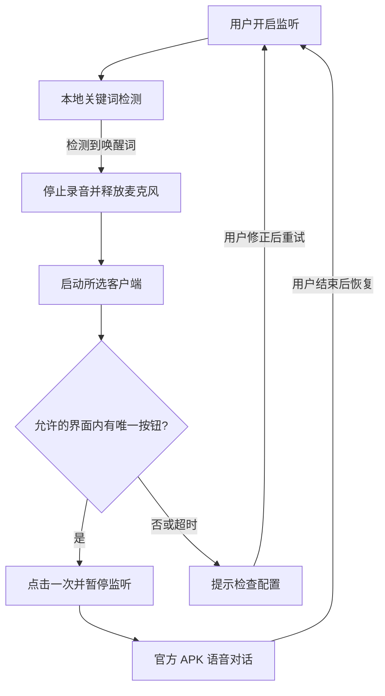

# VoiceToAI Bridge · 语音唤醒桥接

说“召唤大模型”，打开所选 **ChatGPT / Gemini / 其他 Android AI 客户端**，并点击语音按钮。AI 对话、识别、回答和播放仍由官方 APK 完成；桥接不使用大模型 API。

这是 **v0.1 Android 原型**，需要在具体设备和客户端版本上联调，尚不是完成全机型适配的音箱 ROM。

## 首版能力

| 功能 | 实现 |
|---|---|
| 离线唤醒 | Sherpa-ONNX 1.12.14 + 中文 Zipformer 3.3M，INT8 encoder / joiner |
| 唤醒词 | 召唤大模型、你好助手、小智小智，任选一个 |
| 客户端 | ChatGPT、Gemini Live、一个自定义客户端槽位 |
| 按钮适配 | 学习用户亲手点击的按钮；或编辑包名、完整资源 ID、中英文标签 |
| 麦克风交接 | 停止录音并释放麦克风 → 启动客户端 → 点击一次 → 暂停监听 |
| 点击约束 | 限定界面包名、完整匹配、可见可点击、歧义拒绝、12 秒超时、锁屏拒绝 |
| 恢复监听 | 结束 AI 对话后点通知，返回桥接应用手动恢复 |
| 隐私 | 不请求 INTERNET；不保存录音、对话、屏幕截图；状态仅驻留内存 |

## 第一次使用

1. 安装官方 AI 客户端，完成登录和麦克风授权，先手动确认语音可用。
2. 安装本项目 debug APK。支持 **Android 8.0+，arm64-v8a / x86_64**；建议先用 Android 12–15 真机验证。客户端自身可能要求更高版本。
3. 打开“语音桥接”，选择唤醒词与客户端。
4. 点“启用无障碍服务”，阅读用途说明后在系统设置开启“语音桥接 · 点击语音按钮”。部分系统对自行安装的 APK 还要求在应用信息中手动“允许受限设置”。
5. 先点“测试”。找不到按钮时点“学习语音按钮”，在 30 秒内**亲手点击客户端的语音 / Live 按钮**。连续对话请不要学习只做文字听写的麦克风按钮。
6. 结束刚才的客户端语音，回到桥接点“开始监听唤醒词”，授权麦克风，建议允许通知。
7. 说“召唤大模型”，**稍等客户端进入聆听状态**再说问题。桥接不缓存或转交唤醒词之后紧接着说的问题。
8. 对话期间桥接暂停录音。结束后点通知 → “已结束 AI 对话，恢复监听”。

通知和应用内的“停止”会取消待执行点击并停止监听。进程被杀或设备重启后需手动重新开启，不会自动恢复录音。

## 适配不同客户端

| 客户端 | 默认启动包名 | 允许操作的界面包名 |
|---|---|---|
| ChatGPT | `com.openai.chatgpt` | `com.openai.chatgpt` |
| Gemini | `com.google.android.apps.bard` | 上述包名及 `com.google.android.googlequicksearchbox` |
| 自定义 | 用户填写 | 用户明确填写，可与启动包名不同 |

包名和预设按钮标签是候选配置，必须在具体 APK 版本上验证。Gemini 的入口与 Google 应用承载的界面可能不在同一个包，因此分开设置。

在“编辑客户端 / 按钮规则”里，每行填写一个完整标签或 ID。**ID 优先，无 ID 匹配才用标签**。不使用模糊子串、猜测坐标或连续盲点。匹配到多个不同按钮时停止，需进一步缩小规则。

“学习按钮”只记录你明确点击的控件 ID / 标签。部分自绘、Compose 或 WebView 控件未提供可用无障碍节点，此时会提示失败；首版不绕过限制。学习后请先退出语音，再测试。

“已进入语音的控件标签”用于防止重复点击，预设未覆盖的版本需要补充。初版不依赖客户端的私有 Intent、未确认的语音 API 或 `Start with Voice` 设置。

## 构建

环境：JDK 17、Android SDK Platform 35 / Build Tools 35.0.0、Python 3.9+。

```bash
python3 tools/prepare_deps.py
./gradlew testDebugUnitTest lintDebug assembleDebug
```

Windows 使用 `python tools/prepare_deps.py` 与 `gradlew.bat testDebugUnitTest lintDebug assembleDebug`。Android Studio 可直接打开本目录。

APK 位于 `app/build/outputs/apk/debug/`：手机与 ARM 主板选 `app-arm64-v8a-debug.apk`；x86 模拟器选 `app-x86_64-debug.apk`。按架构拆包，避免让手机携带模拟器 native 库。首次准备下载约 40 MB AAR 和 32 MB 模型归档并校验固定 SHA-256；后续复用缓存。只有所需模型进入 APK，下载发生在构建时，应用不联网下载模型。

GitHub Actions 的 **Android APK** 工作流会执行测试、Lint、构建，产物名为 `voicetoai-bridge-debug`，下载解压后安装 APK。debug 签名仅适合测试；不同环境 debug 密钥可能不同，升级签名冲突时需卸载旧版（会清除配置）。正式分发需单独管理 release 签名。

## 架构



- `MainActivity`：中文设置、授权说明、规则编辑、学习和测试入口。
- `WakeService`：麦克风前台服务、通知、单线程队列、取消过期回调。
- `SherpaWakeEngine`：16 kHz 单声道采集；工作线程独占 native 资源，返回检测结果前先释放麦克风。
- `VoiceAccessibilityService`：限时查找 / 单击或学习；待机时不订阅 AI 界面事件。
- `BridgePolicy` / `ClientProfile`：完整匹配、包名 / 规则验证。

## 当前边界

- 能构建 APK 不等于已验证特定 ChatGPT / Gemini 版本；客户端登录、网络、账号限制由用户与官方应用处理。
- **初版手动恢复监听**，不根据页面离开或定时器猜测会话结束。系统报告有其他录音时会阻止新监听，但各厂商的音频可见性不同，请先结束 AI 语音再恢复。
- 普通 APK 受前台服务、后台 Activity 启动、电池管理和锁屏限制，不能保证任意系统永久后台监听。从可见界面启动麦克风服务，通过用户开启的无障碍服务请求启动客户端，失败时提示。
- 不自动解锁或处理登录 / 授权弹窗。专用硬件先亮屏、解锁验证，再决定 ROM、默认桌面和供电策略。
- 不实现远场 AEC 或播放打断；正式对话的回声处理由音频栈和客户端承担。AI 对话期间不能再用桥接唤醒词切换客户端。
- “轻量”指桥接逻辑，不代表几百 KB APK；离线唤醒包含 native runtime 与模型。持续监听有耗电，适合接电验证。
- 任意中文新唤醒词、按不同唤醒词路由不同客户端、自动检测会话结束、墨水屏状态输出留待后续。

真机检查：[docs/device-validation.md](docs/device-validation.md)。组件说明：[THIRD_PARTY_NOTICES.md](THIRD_PARTY_NOTICES.md)。

## 技术资料

- [Sherpa-ONNX 中文关键词模型](https://k2-fsa.github.io/sherpa/onnx/kws/pretrained_models/index.html)
- [Android 音频共享](https://developer.android.com/media/platform/sharing-audio-input)
- [麦克风前台服务限制](https://developer.android.com/develop/background-work/services/fgs/service-types)
- [Android 无障碍服务](https://developer.android.com/guide/topics/ui/accessibility/service)
- [后台 Activity 启动约束](https://developer.android.com/guide/components/activities/background-starts)
